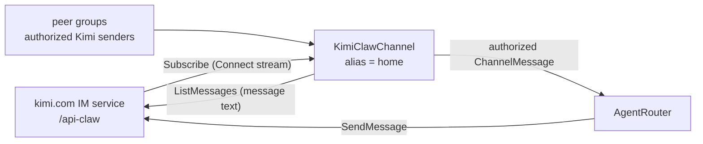

# Kimi Claw

Run a ZeroClaw agent as a bot on [Kimi Claw](https://kimi.com/bot), the chat
surface on kimi.com. This is a native Rust channel: it speaks the same IM RPC
protocol as Kimi's official `kimi-claw` OpenClaw plugin (`im_rpc`), so no
Node.js process, OpenClaw install, or external bridge is needed.

The channel is compiled into default builds (`channel-kimi-claw` is part of
`default-channels`) and stays inactive until you enable it in config.

## How it works



- **Auth:** every request carries the bot token in `X-Kimi-Bot-Token`.
- **Inbound:** a long-lived Buf Connect JSON stream on
  `kimi.gateway.im.v1.IMService/Subscribe`. Events carry only metadata, so for
  each completed user message the channel reads its text with a scoped
  `ListMessages` call, exactly like the official plugin.
- **Outbound:** each reply is one unary `SendMessage` with a text block.
- **Resilience:** the server pings about every 10 s; 30 s of silence forces a
  reconnect. Reconnects resume from the last processed event (`sinceId`), a
  server `reconnect` event reconnects immediately, and failures back off from
  1 s up to 5 min with jitter. Message ids are de-duplicated so a replay never
  runs a turn twice. A 401/403 stops the channel instead of retrying.

## 1. Get a Kimi Claw bot token

1. Open [kimi.com/bot](https://kimi.com/bot) and create or open your bot.
2. Choose **Link Existing OpenClaw** (the same token works for ZeroClaw).
3. Copy the bot token.

Treat the token like a password. Do not paste it into `config.toml`, logs,
screenshots, or source control.

## 2. Configure an alias and attach it to an agent

Set the token through the masked secret prompt, then enable the channel:

```sh
zeroclaw config set channels.kimi_claw.home.token
zeroclaw config set channels.kimi_claw.home.enabled true
zeroclaw config set agents.primary.channels   # add "kimi_claw.home"
```

The resulting non-secret structure is equivalent to:

```toml
[channels.kimi_claw.home]
enabled = true
# token is stored encrypted after the masked `config set` prompt
# Optional:
# user_id = "..."        # the bot's own Kimi id; its own messages are ignored
# api_host = "https://www.kimi.com/api-claw"
# proxy_url = "socks5h://127.0.0.1:1080"

[agents.primary]
channels = ["kimi_claw.home"]
```

| Key | Required | Default | Purpose |
|---|---|---|---|
| `enabled` | yes | `false` | Start this channel instance. |
| `token` | yes | — | Kimi Claw bot token (secret, stored encrypted). |
| `user_id` | no | — | Bot's own Kimi id, used to drop its own messages. |
| `api_host` | no | `https://www.kimi.com/api-claw` | IM RPC base URL override. |
| `proxy_url` | no | global `[proxy]` | Per-channel proxy. |
| `excluded_tools` | no | `[]` | Tools hidden from the model on this channel. |

## 3. Authorize senders

Authorization is deny-by-default and lives in [Peer Groups](./peer-groups.md).
A sender is admitted when its Kimi `senderId` or `senderShortId` is listed:

```toml
[peer_groups.kimi_home]
channel = "kimi_claw.home"
external_peers = ["your-kimi-sender-id"]
```

Rejected senders are logged as `kimi claw inbound skipped (allowlist)` with
their `sender_id`, which is the value to add. `external_peers = ["*"]` admits
everyone who can reach the bot; use it only for a deliberately public bot with
a restricted agent.

## Limits of this version

Text in and text out. Streaming drafts (`SendMessageStream`), file and image
upload/download, typing indicators, and the plugin's terminal/ACP ingress are
not implemented yet. Run only one consumer per bot token: do not keep an
OpenClaw plugin or a Node bridge subscribed with the same token while this
channel is enabled.
